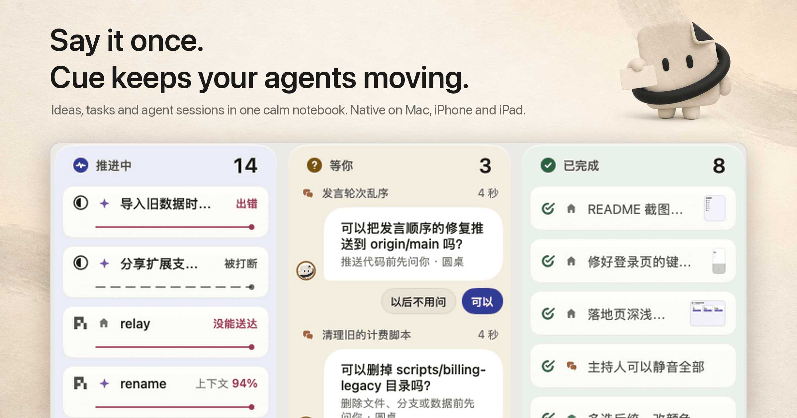

English | <a href="README.zh-CN.md">简体中文</a>

  

  <b>A calm notebook that runs your coding agents for you.</b> 
  Native on Mac, iPhone and iPad. Local-first, no CuePad account.

<b>A major update is on the way.</b> This page will be rewritten when it lands.

  <a href="https://github.com/Suge8/CuePad/releases/latest">Download for Mac</a> ·
  <a href=".github/CONTRIBUTING.md">Build from source</a> ·
  <a href="LICENSE">Apache 2.0</a>

