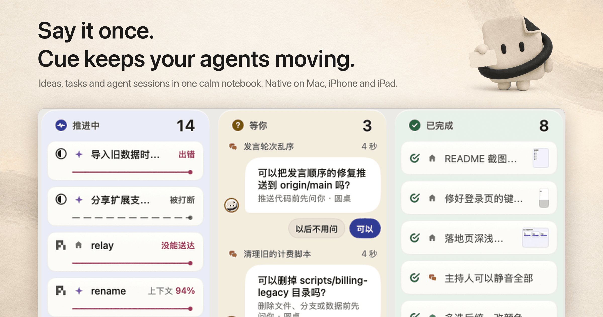
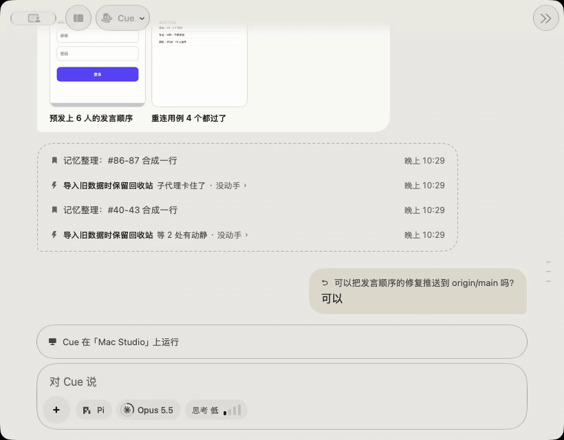
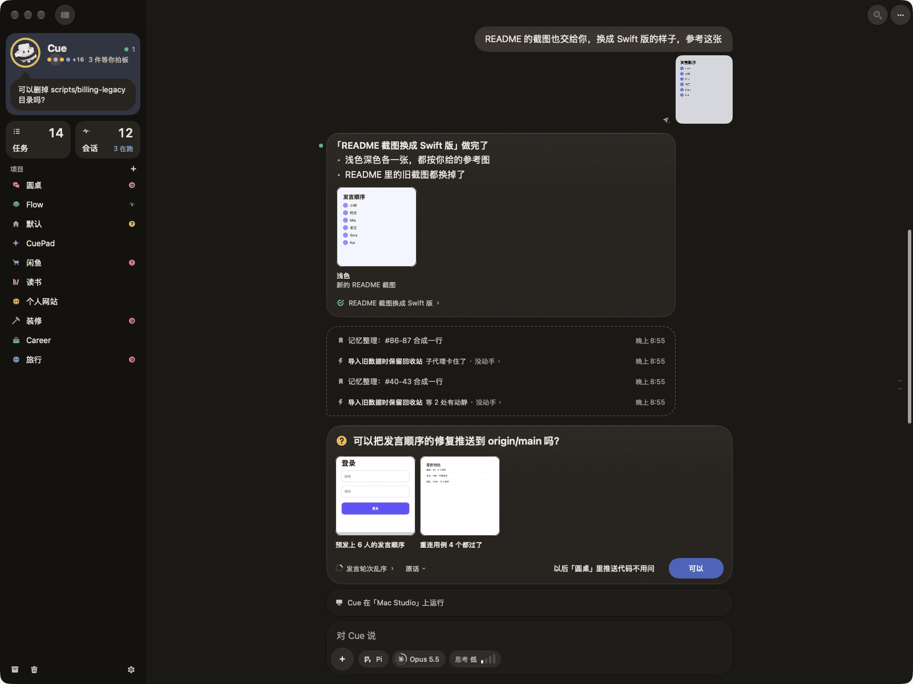
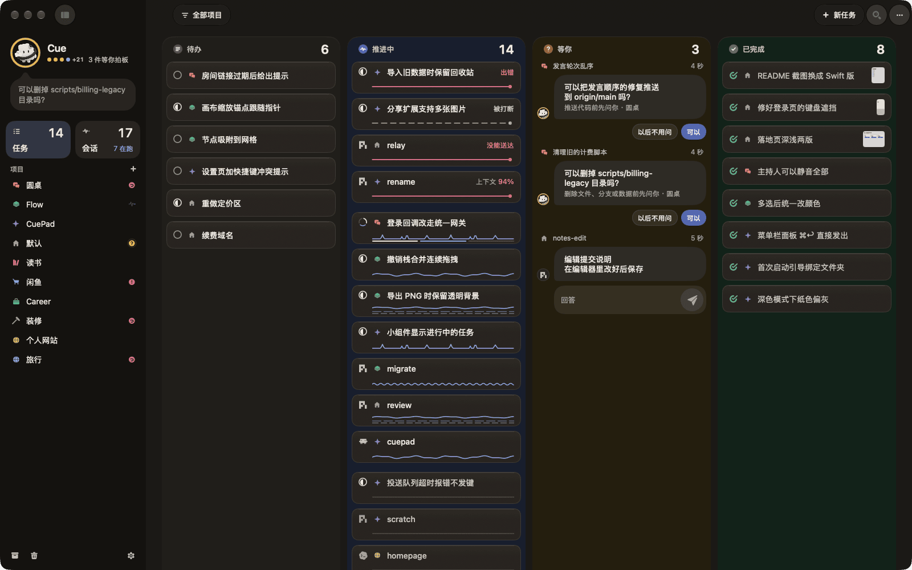
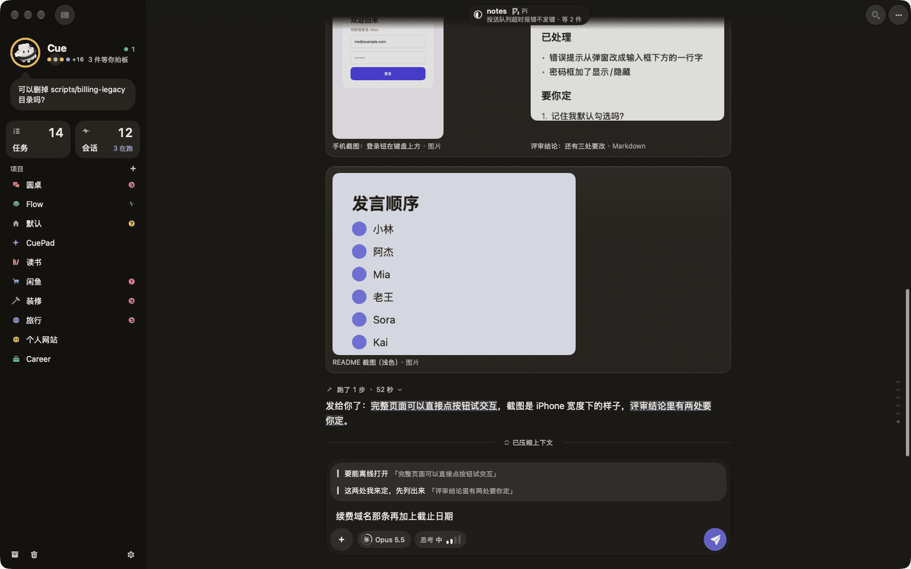
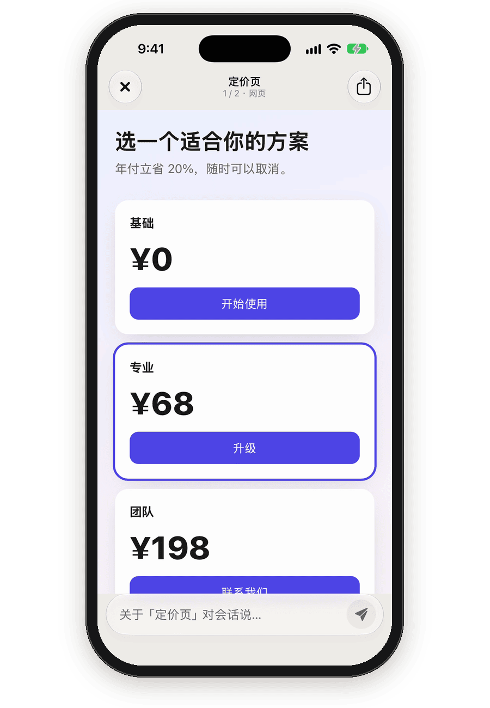

<p align="right">English | <a href="README.zh-CN.md">简体中文</a></p>

<p align="center">
  
</p>

<p align="center">
  <b>A calm notebook that runs your coding agents.</b><br />
  Jot it down; Cue hands it to Claude Code, Codex, Pi, OpenCode or Grok Build, keeps them moving, and only asks you what really needs you.<br />
  Native on Mac, iPhone and iPad. Local-first, no account, no server.
</p>

<p align="center">
  <a href="https://github.com/Suge8/CuePad/releases/latest"><b>Download for Mac</b></a> ·
  <a href="#quick-start">Build from source</a> ·
  <a href="https://cue-pad.com">cue-pad.com</a>
</p>

<p align="center">
  <a href="LICENSE"></a>
  
  
</p>

<p align="center"></p>

## Why CuePad

- **Cue runs your agents for you.** Say what you want, typed on the Mac or from your phone. Cue turns it into tasks, starts and names agent sessions, answers their routine questions, checks their evidence and signs off finished work. It comes back only for what can't be undone (pushing, releasing, deleting): everything waiting on you is one number, *Waiting N*, one tap each.
- **On schedule.** "Every Monday at 9, clean up stale branches": a schedule can repeat and hang on a task, and Cue starts the work when it's due. If the Mac was asleep, it catches up once when it wakes.
- **One home for skills and rules.** Skills live in `~/.agents/skills`, rules in one `AGENTS.md` for all four agents (and one per project). CuePad marks which agent can't read what and lets you edit any skill or rule right in the app, from your phone too. One tap gathers scattered skills and links Claude Code in; duplicate skills and diverging rule files are a tap away from one copy — and on the Mac, every change can be undone.
- **Every agent on one board.** Tasks move through four lanes — to do, advancing, waiting on you, done — with each session's live state next to them: thinking, running a tool, waiting, finished.
- **Your phone is the remote.** Answer an agent's question or permission request from anywhere. Agents send you screenshots, pages, PDFs and recordings to check, each captioned with what to look at.
- **Ideas first.** Plain Markdown with inline images and `{{variables}}`. When it's time to act, drag an idea onto a task and it joins the task's notes; every send is logged and can be resent.
- **Yours.** Everything lives in a SQLite library on your device and syncs through your own private iCloud database. No account, no server, no telemetry.

| | |
|:-:|:-:|
|  |  |
| Cue reports back with proof, and asks only what needs you | Every task on one board; answer Cue in one tap |
|  |  |
| Agents send you pages and screenshots; annotate any part of a reply | Check an agent's work from your phone |

> The interface is in Simplified Chinese for now.

## Quick start

**1. Get the app.** Download the notarized Mac build from [Releases](https://github.com/Suge8/CuePad/releases/latest) (macOS 26+), or build it yourself — macOS 26 and Xcode 27, no Apple developer account needed:

```bash
git clone https://github.com/Suge8/CuePad.git
open CuePad/apple/CuePad.xcodeproj    # pick the CuePad scheme and My Mac, then ⌘R
```

A build from source is ad-hoc signed, keeps its own library in `~/Library/Application Support/CuePad Dev` and doesn't update itself (`git pull` and build again). If the released app is also on this Mac, the source build leaves your agents' settings and notifications to it. iCloud sync and the iPhone/iPad apps need your own Apple developer account ([docs/release.md](docs/release.md#换成自己的身份fork)).

**2. Connect your agents.** On first launch CuePad finds the agents on this Mac — [Pi](https://pi.dev), Claude Code, Codex, OpenCode, Grok Build — and connects the ones you tick; one that's missing or signed out is one click to install or sign in. Each row says what it will write before anything is written, and turning an agent off later removes all of it. Work happens in the project's folder, `~/CuePad/<project>` unless you point it at your own code.

**3. Hand off your first job.** Press `Option + Shift + Space` anywhere and tell Cue what you want, e.g. *"Add a dark mode toggle to ~/code/my-app and show me a screenshot."* Or write a task and press **Start**. Cue picks the agent, starts the session, and the result lands back in CuePad.

## `cuepad` for your agents

Every connected agent also gets `cuepad`, a command line over the same library, so it can look things up, take notes, keep a to-do list across sessions and send you previews:

```bash
cuepad search deploy script                 # find ideas and tasks
printf 'Release checklist…' | cuepad card add
cuepad task add Write release notes
cuepad show shot.png --title "The new toggle, top right"
```

`cuepad --help` is the full reference. Inside a folder bound to a project it works on that project; `--json` gives stable output.

## Contributing

Issues and pull requests are welcome — see [CONTRIBUTING.md](.github/CONTRIBUTING.md). Project conventions for humans and coding agents are in [AGENTS.md](AGENTS.md); report security issues as described in [SECURITY.md](.github/SECURITY.md).

## License

[Apache 2.0](LICENSE). Third-party components are listed in [THIRD-PARTY-NOTICES.md](THIRD-PARTY-NOTICES.md).
