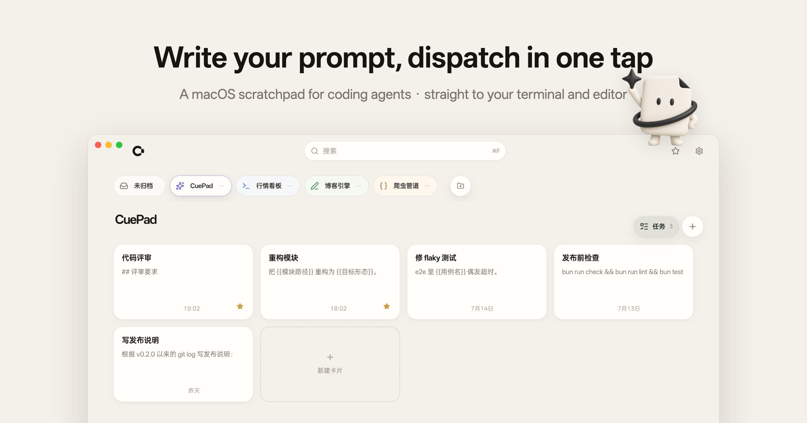

<p align="right">English | <a href="README.zh-CN.md">简体中文</a></p>

<!-- TODO 截图待更新：以下图片仍是旧版界面，Swift 版截图另行安排，路径保持不变即可替换 -->
<p align="center">
  
</p>

<p align="center">
  <a href="LICENSE"></a>
  
</p>

**CuePad is a thinking space for working with coding agents.** Write prompts, jot down ideas and goals, see what your agents are doing, and hand text to them in one tap. A calm, paper-like notebook, native on Mac, iPhone and iPad, synced through iCloud.

Local-first: everything lives in a SQLite database on your device; iCloud sync uses your own private CloudKit database. No account, no server, no telemetry.

<!-- TODO 截图待更新 -->
<p align="center">
  
</p>

## Features

- **Capture → polish → send → look back.** Cards hold any amount of text with inline images, `{{variables}}` and dividers; tasks are one-line to-dos, global or per project. Everything autosaves.
- **Send to agents.** Deliver a card to a running [Pi](https://pi.dev) session (text and images, no Accessibility permission needed) or to any app via clipboard and a targeted `Cmd+V`. Every send is logged with a snapshot and can be resent.
- **See your agents.** Pi sessions show live state (thinking, running a tool, waiting for you, done) and history; sessions file under the project bound to their working directory.
- **Projects that know your code.** Bind a project to a code directory: Pi sessions and the `cuepad` command line pick the right project from where they run.
- **Selections and variables.** Send the whole card or just the selected part, or turn selected lines into tasks; fill `{{variables}}` right before sending, each card remembers its last values.
- **Search everywhere.** `⌘K` searches projects, cards and tags, filtered by project, images, send target or time.
- **Mac.** Glass sidebar, a menu bar scratch pad that sends with `⌘↩`, and a global shortcut (`Option + Space` by default) to bring CuePad up from anywhere.
- **iPhone and iPad.** A project bookshelf, quick capture bar, share extension and widgets. Cards written on the phone are on the Mac a moment later, and the phone can send text to a Pi session on your Mac.
- **iCloud sync.** Per-record sync; if the same card is edited offline on two devices, both versions are kept for you to choose from.

## `cuepad`: memory for your agents

`cuepad` is a command line that reads and writes the same library as the app, so an agent can look things up, take notes and keep a to-do list between sessions:

```bash
cuepad search deploy script        # find cards (every word must match)
printf 'Release checklist…' | cuepad card add   # save a card
cuepad task add Write release notes
cuepad task done <id>
```

Run inside a directory that a project is bound to and it works on that project by default. `--json` gives stable output for agents. Install it from CuePad's Settings (it links to `~/.local/bin/cuepad`); `cuepad --help` and `cuepad <command> --help` are the full reference.

## Download

Get the latest Mac build from [GitHub Releases](https://github.com/Suge8/CuePad/releases/latest) (Developer ID signed and notarized; macOS 26 or later). iPhone and iPad builds ship through TestFlight. Product site: [cue-pad.com](https://cue-pad.com).

## Build from source

Requires Xcode 26. Local builds are ad-hoc signed, so no developer account is needed.

```bash
git clone https://github.com/Suge8/CuePad.git
cd CuePad
apple/scripts/xc.sh build mac    # also: build ios, test mac, shot mac
cd apple/CuePadKit && swift test
```

Architecture, commands and conventions: [docs/development.md](docs/development.md).

## Contributing

Contributions are welcome — see [CONTRIBUTING.md](.github/CONTRIBUTING.md), and [SECURITY.md](.github/SECURITY.md) for reporting vulnerabilities.

## License

Apache License 2.0. See [LICENSE](LICENSE).
