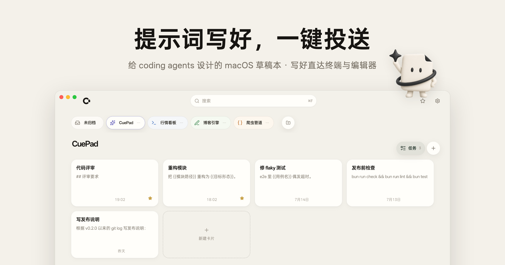
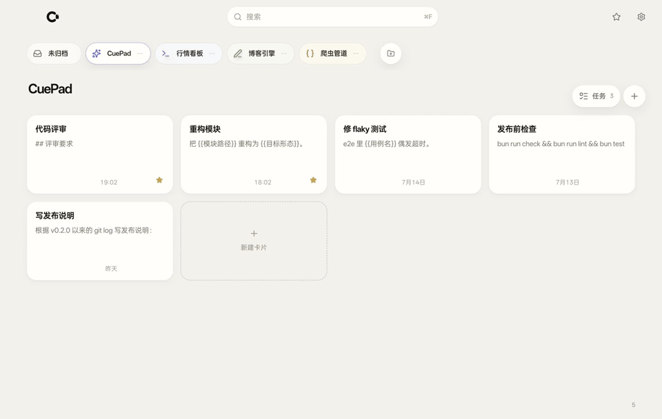

<p align="right"><a href="README.md">English</a> | 简体中文</p>

<!-- TODO 截图待更新：以下图片仍是旧版界面，Swift 版截图另行安排，路径保持不变即可替换 -->
<p align="center">
  
</p>

<p align="center">
  <a href="LICENSE"></a>
  
</p>

**CuePad 是与 coding agents 协作时的思考空间。** 记灵感、把要做的变成任务、看 Agent 在做什么、把文字一键交给它。一本安静的纸感笔记本，Mac、iPhone、iPad 原生，经 iCloud 同步。

本地优先：所有数据保存在设备上的 SQLite 库里；iCloud 同步用的是你自己的私有 CloudKit 数据库。无需账号，没有服务器，没有遥测。

<!-- TODO 截图待更新 -->
<p align="center">
  
</p>

## 功能

- **灵感 → 任务 → Agent**：灵感承载任意长的文字，含内联图片、`{{变量}}` 与分割线；点"要做"它就成了任务，正文就是交给 Agent 的话，可带子任务与素材。项目只是容器，带一句介绍。逐键自动保存。
- **交给 Agent**：把灵感或任务直达运行中的 Agent 会话（目前支持 [Pi](https://pi.dev)，图文皆可，无需辅助功能权限），或经剪贴板与定向 `Cmd+V` 送进任意应用。每次发送自动记录内容快照，可一键重发。
- **看见 Agent**：Agent 会话显示实时状态（思考中、跑工具、等你、完成）与历史，并按工作目录归入对应项目。
- **懂代码的项目**：项目可绑定代码目录，Agent 会话与 `cuepad` 命令行按所在目录自动选中项目。
- **选区与变量**：整条发送，或选中一段只发这一段、把选中的几行转成任务；发送前集中填写 `{{变量}}`，每条记住上次的值。
- **随处搜索**：`⌘K` 搜项目、灵感与任务，可按项目、含图片、发送目标、时间筛选。
- **Mac**：玻璃侧栏、`⌘↩` 直接发出的菜单栏小稿纸、全局快捷键（默认 `Option + Space`）随时唤回。
- **iPhone 与 iPad**：项目书架、随手记输入栏、分享扩展与小组件。手机上记的灵感稍后出现在 Mac 上，手机也能把文字发给 Mac 上的 Agent 会话。
- **iCloud 同步**：按记录同步；同一条在两台设备离线并发编辑时，两个版本都保留，由你选择。

## `cuepad`：给 agent 的记忆

`cuepad` 是读写同一个资料库的命令行，agent 可以在会话之间查资料、记笔记、管待办：

```bash
cuepad search 部署 脚本                      # 查灵感与任务（每个词都要命中）
printf '发布清单…' | cuepad card add          # 记一条灵感
cuepad task add 写发布说明
cuepad task done <id>
```

在绑定了目录的项目里运行时，默认只作用于该项目。`--json` 给 agent 稳定的输出。在 CuePad 设置里安装（链接到 `~/.local/bin/cuepad`）；完整用法见 `cuepad --help` 与 `cuepad <命令> --help`。

## 下载

Mac 版见 [GitHub Releases](https://github.com/Suge8/CuePad/releases/latest)（Developer ID 签名并公证，需 macOS 26 或更高）。iPhone 与 iPad 版经 TestFlight 分发。产品站：[cue-pad.com](https://cue-pad.com)。

## 从源码构建

需要 Xcode 27。本机构建用 ad-hoc 签名，不需要开发者账号。

```bash
git clone https://github.com/Suge8/CuePad.git
cd CuePad
apple/scripts/xc.sh build mac    # 还有 build ios、test mac、shot mac
cd apple/CuePadKit && swift test
```

架构、命令与约定见 [docs/development.md](docs/development.md)。

## 参与贡献

欢迎贡献——参见 [CONTRIBUTING.md](.github/CONTRIBUTING.md)；安全问题请看 [SECURITY.md](.github/SECURITY.md)。

## 许可证

Apache License 2.0，详见 [LICENSE](LICENSE)。
