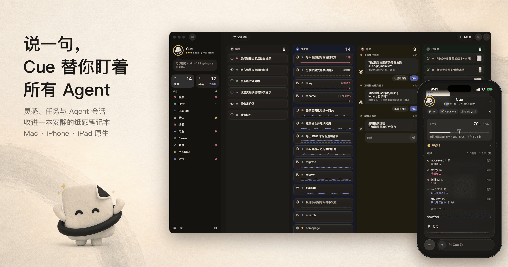

<a href="README.md">English</a> | 简体中文

  

  <b>一本替你指挥 coding agent 的安静笔记本。</b> 
  Mac、iPhone、iPad 原生。本地优先，无需 CuePad 账号。

<b>即将大更新。</b>更新落地后这一页会重写。

  <a href="https://github.com/Suge8/CuePad/releases/latest">下载 Mac 版</a> ·
  <a href=".github/CONTRIBUTING.md">从源码编译</a> ·
  <a href="LICENSE">Apache 2.0</a>

