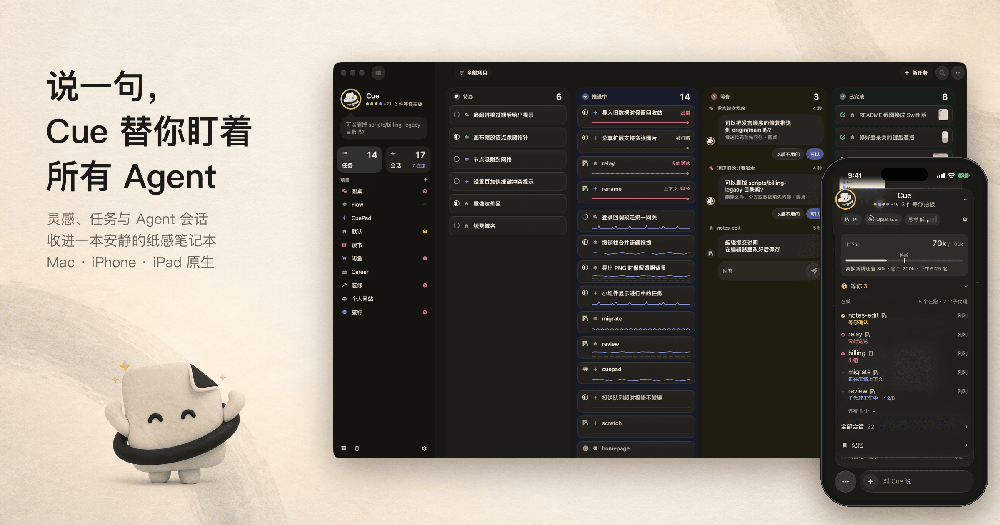

<p align="right"><a href="README.md">English</a> | 简体中文</p>

<p align="center">
  
</p>

<p align="center">
  <b>一本替你指挥 coding agent 的安静笔记本。</b><br />
  记下来，Cue 交给 Claude Code、Codex、Pi 或 OpenCode，盯着它们推进，只把真正要你拍板的事拿来问你。<br />
  Mac、iPhone、iPad 原生。本地优先，无需账号，没有服务器。
</p>

<p align="center">
  <a href="https://github.com/Suge8/CuePad/releases/latest"><b>下载 Mac 版</b></a> ·
  <a href="#快速上手">从源码编译</a> ·
  <a href="https://cue-pad.com">cue-pad.com</a>
</p>

<p align="center">
  <a href="LICENSE"></a>
  
  
</p>

<p align="center"></p>

## 为什么用 CuePad

- **Cue 替你指挥 Agent。** 在 Mac 上打字或在手机上说出你要什么，Cue 把它变成任务、开好并命名 Agent 会话、回答常规提问、核对证据、自己判定做完。只有推送、发布、删除这类收不回的事才来问你：所有在等你的事汇成一个数字“等你 N”，点一下答一件。
- **所有 Agent 在一块看板上。** 任务按待办、推进中、等你、已完成四列走，旁边是每个会话的实时状态：思考中、跑工具、等你、完成。
- **手机就是遥控器。** 在哪都能回答 Agent 的提问和权限请求；Agent 把截图、网页、PDF、录屏发到你手机上验收，每个文件都写明看哪里。
- **灵感优先。** 纯 Markdown，带内联图片与 `{{变量}}`；要动手时一点就变成任务，每次发送都留快照、可重发。
- **数据是你的。** 全部存在设备上的 SQLite 库里，经你自己的 iCloud 私有数据库同步。无需账号，没有服务器，没有遥测。

| | |
|:-:|:-:|
|  |  |
| Cue 带着证据交差，只问要你拍板的事 | 所有任务一块看板，Cue 的提问点一下就答 |
|  |  |
| Agent 把页面、截图发进对话，回答里任意一段都能批注 | 在手机上验收 Agent 的成果 |

## 快速上手

**1. 装上 App。** 从 [Releases](https://github.com/Suge8/CuePad/releases/latest) 下载已公证的 Mac 版（macOS 26+），或自己编译——需要 macOS 26 与 Xcode 27，不需要 Apple 开发者账号：

```bash
git clone https://github.com/Suge8/CuePad.git
open CuePad/apple/CuePad.xcodeproj    # 选 CuePad scheme 与 My Mac，然后 ⌘R
```

自己编的版本是 ad-hoc 签名，资料库单独放在 `~/Library/Application Support/CuePad Dev`，不会自动更新（`git pull` 后重新编）。这台 Mac 上也装着正式版时，Agent 的接入与通知留给正式版，自己编的不去动。iCloud 同步与 iPhone、iPad 版要用你自己的 Apple 开发者账号（[docs/release.md](docs/release.md#换成自己的身份fork)）。

**2. 接上 Agent。** 第一次打开时，CuePad 找出这台 Mac 上的 Agent（[Pi](https://pi.dev)、Claude Code、Codex、OpenCode），勾上的就接入；没装或没登录的一点就装、就登录。每一行都写明会写什么，点了才写，以后关掉某一家就把写过的全部删掉。活在项目的文件夹里做，默认是 `~/CuePad/<项目名>`，也可以指向你已有的代码目录。

**3. 派出第一件事。** 在任何地方按 `Option + Shift + Space` 告诉 Cue 你要什么，比如“给 ~/code/my-app 加一个深色模式开关，做完给我看截图”；或者写一条任务、点“开始”。Cue 挑好 Agent、开好会话，结果回到 CuePad 里。

## `cuepad`：给 Agent 的命令行

接入的每家 Agent 都会拿到 `cuepad`，一个读写同一个资料库的命令行：在会话之间查资料、记笔记、管待办、把预览发给你：

```bash
cuepad search 部署 脚本                      # 查灵感与任务
printf '发布清单…' | cuepad card add
cuepad task add 写发布说明
cuepad show shot.png --title "新开关在右上角"
```

完整说明见 `cuepad --help`。在绑定了项目的目录里运行就作用于那个项目；`--json` 输出稳定格式。

## 参与贡献

欢迎提 Issue 与 PR，见 [CONTRIBUTING.md](.github/CONTRIBUTING.md)。给人和 coding agent 的项目约定在 [AGENTS.md](AGENTS.md)；安全问题按 [SECURITY.md](.github/SECURITY.md) 私下报告。

## 许可证

[Apache 2.0](LICENSE)。第三方组件见 [THIRD-PARTY-NOTICES.md](THIRD-PARTY-NOTICES.md)。
